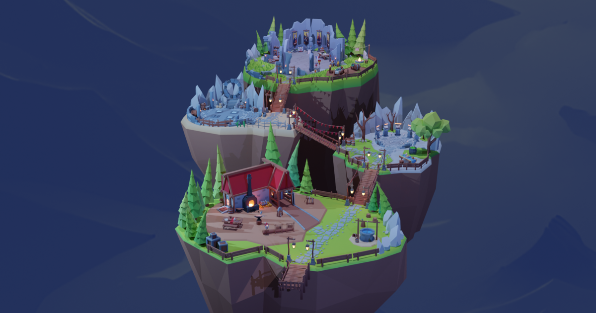

# Mike Fernandez — 3D Portfolio

An interactive 3D portfolio: a low-poly floating archipelago at night that
you explore as a little knight. Each island holds part of the portfolio — the
projects behind a portal, the skills around a cauldron and a glowing glyph,
the resume, and the contact links at the forge.

**Live: https://mike-fernandez.dev**



## Controls

|             | Desktop                      | Mobile             |
| ----------- | ---------------------------- | ------------------ |
| Move        | WASD / arrow keys            | On-screen joystick |
| Sprint      | Left Shift                   | —                  |
| Jump        | Space                        | —                  |
| Open a link | Enter at a glowing indicator | Tap the indicator  |

Step on the project plates to pick the project the portal shows.

## Browser support

Renders with three.js' WebGPURenderer: WebGPU where the browser has it, an
automatic WebGL2 fallback everywhere else.

## Tech highlights

- **React Three Fiber 10** on three's **WebGPURenderer**, with drei 11.
- **TSL everywhere**: every custom material (grass, smoke, clouds, dissolve,
  sparks, wind lines...) is a three.js node material, no GLSL.
- **Custom physics**: one capsule character against static BVH trimeshes
  (three-mesh-bvh) instead of a physics engine. Its solver reproduces
  rapier's measured behavior, checked frame by frame against rapier by
  `scripts/physics-parity.mjs`.
- **TSL post-processing pipeline**: GTAO, cheap depth of field, bloom,
  vignette, ACES tone mapping, an iris transition and SMAA (with 4x MSAA on
  desktop).
- **GSAP** for the scripted sequences (intro camera pan, portal, death and
  respawn...); `prefers-reduced-motion` swaps the motion-heavy ones for
  calmer versions.
- **Debug stack**: in dev, open `http://localhost:5173/#debug` for three's
  Inspector (per-pass performance, memory, render targets) with every tuning
  control in its Parameters tab. Production builds tree-shake it out.

## Development

```sh
pnpm install
pnpm dev     # http://localhost:5173 (#debug: debug panel)
pnpm build
pnpm lint    # src and scripts
```

### Scripts

- `pnpm pack-textures`: packs source textures from `src/assets/textures`
  into the channel-packed maps, the screens atlas and the grass placement
  mask, then compresses them to KTX2 (needs the KTX-Software `ktx` CLI
  v5+).
- `pnpm physics-parity`: runs the island colliders through the custom
  physics and through rapier with the same scripted inputs, and reports the
  deviation. Run it after any change to `src/physics/`.
- `pnpm check-wgsl`: builds the WGSL of the shader materials in Node (no
  GPU) and reports build errors, unassigned variable reads and unreviewed
  `pow()` bases.
- `pnpm smoke` (after `pnpm build`): opens the build in a headed Chrome on
  WebGPU and on the WebGL 2 fallback, presses Enter, and fails on console
  errors, exceptions or frames not drawn through the expected backend.
- `scripts/make-typeface.mjs`: converts the skills font to three's typeface
  JSON, keeping only the glyphs the scene draws (see its header for the
  `OPENTYPE` setup).
- `scripts/strip-falling-clip.mjs`: strips the falling animation GLB down to
  the tracks the character plays. Run it after re-exporting the clip.

## Credits

The sounds and music come from Pixabay: see
[public/Copyrights.md](public/Copyrights.md) for the full list.

## License

The code is under the [MIT License](LICENSE). The 3D models, textures,
sounds, music and fonts are not covered by it; the sounds and music stay
under their creators' licenses, listed in
[public/Copyrights.md](public/Copyrights.md).
